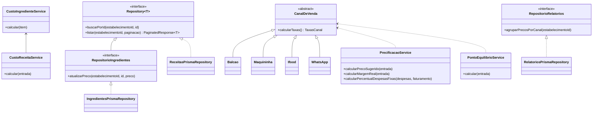
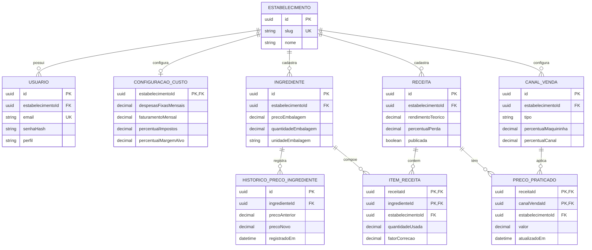

# Arquitetura e persistência

O núcleo de cálculo está em `apps/api/src/domain/`. O Prisma fica na infraestrutura. Os repositórios recebem o cliente por construtor, consultam o PostgreSQL e devolvem contratos que o domínio pode consumir sem importar o Prisma. A fase HTTP liga esses contratos aos serviços NestJS.

## Diagrama de classes

## Diagrama do banco

### Decisões de persistência

- `ItemReceita` implementa Receita N:N Ingrediente. `PrecoPraticado` implementa Receita N:N CanalVenda, com um preço atual por combinação. As chaves estrangeiras compostas incluem o estabelecimento e bloqueiam vínculos entre estabelecimentos.
- Custos, quantidades e fatores usam `NUMERIC(18,6)`. Percentuais usam `NUMERIC(8,6)`. O preço praticado usa `NUMERIC(18,2)`. Os repositórios convertem os valores a strings decimais na fronteira. Os cálculos usam a precisão do domínio.
- O histórico de ingredientes armazena o preço anterior, o novo e a data da alteração. A transação bloqueia a linha antes de ler o preço anterior. Repetir o mesmo preço retorna o registro sem acrescentar histórico.
- O resumo de preços usa `groupBy` para contar receitas com preço e calcular o preço médio por canal. Canais sem preço retornam contagem zero e média nula. A comparação com a margem desejada usa os custos atuais no domínio e entra no relatório da fase HTTP.
- A aplicação usa `DATABASE_URL` quando configurada. O Prisma CLI usa `DIRECT_DATABASE_URL` se ela estiver presente. No desenvolvimento, ambos podem usar as configurações `POSTGRES_*` do Docker. A conexão do Neon será configurada na publicação.
- As restrições SQL `CHECK` estão na migration. O schema Prisma mantém tipos, chaves e relacionamentos. Ao mudar uma coluna protegida, revise também a restrição na migration correspondente.
